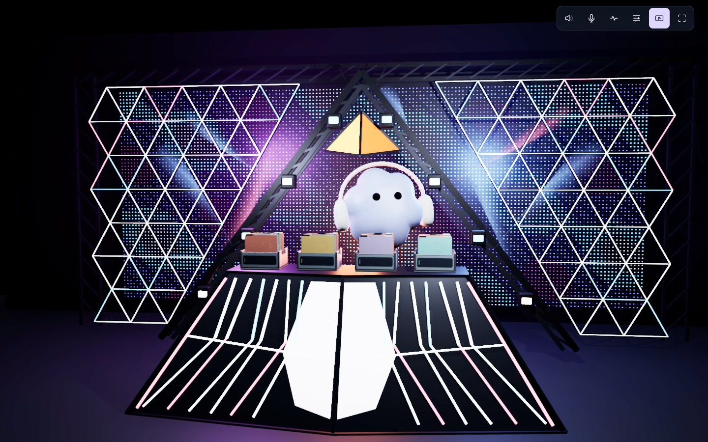

# Dawt

Dawt is a real-time DJ character for [Afterhours](https://github.com/robertschultz/afterhours). Unreal Engine renders the
character and venues, Pixel Streaming brings the booth to the browser, and
Afterhours drives playback through VirtualDJ.

## Run locally

You’ll need macOS, Unreal Engine 5.8, Node.js 24, Python 3, and Xcode. Build
the web client, then open `unreal/DotPerformance.uproject` in Unreal and
build the project modules when prompted.

```sh
npm --prefix web/src ci
npm --prefix web/src run build
python3 scripts/launch.py
```

| Page | What you can do |
| --- | --- |
| [Standalone stage](http://127.0.0.1:8170/) | Preview Dawt, cue moves, change the backdrop, and toggle headphones. |
| [DJ booth](http://127.0.0.1:8170/dj) | Run the booth with [Afterhours](https://github.com/robertschultz/afterhours), follow the current and next tracks, and switch venues or cameras. |

For the DJ booth, run `python3 scripts/launch.py --dj`. The launcher reuses a
local [Afterhours](https://github.com/robertschultz/afterhours) service on port 8765 by default. To start your own engine
checkout, set `DOT_AFTERHOURS_ENGINE` to that checkout after setting up its
Python environment. VirtualDJ and any music-provider accounts are configured
locally. For audible browser playback, choose **Hear stream** and grant macOS
system audio recording permission to the Dawt audio helper when prompted.

Run `python3 scripts/launch.py --stop` to stop the local renderer and signaling
service. Set `DOT_UNREAL_EDITOR` if Unreal is installed at a custom path.

## In the booth

- **Booth controls** opens the queue, crate search, pacing, and scene selector.
  The table, record crates, and headphones have separate switches.
- **Cinematic camera** changes framing around record pulls, handoffs, and dance accents.
- **DJ activity** follows the current action and shows its latest detail.
- **Talk** sends voice requests through [Afterhours](https://github.com/robertschultz/afterhours). Dawt grooves to the
  playing deck’s beat grid, including through tempo and deck changes.

The header shows the **Daft Punk Pyramid · Coachella / Alive** scene. Its
illuminated podium, triangular lighting grids, and suspended crown were modeled
in Blender. [Coachella festival archive](https://doc.coachella.com/)

## Project layout

| Folder | Contents |
| --- | --- |
| [`unreal/`](unreal/) | Unreal project, performer, cameras, and imported scene assets. |
| [`web/src/`](web/src/) | Browser controls, activity, voice client, and local signaling. |
| [`assets/`](assets/) | Editable Blender scenes, FBX exports, and material palettes. |
| [`scripts/`](scripts/) | Launchers, Unreal import scripts, and the macOS audio helper. |

Open [the pyramid Blender scene](assets/warehouse/dot-alive-pyramid.blend)
to edit the stage. Run `scripts/build_alive_pyramid.py` inside Blender to
regenerate its exchange files. Import the two meshes, `VenueAlivePyramid`
and `AlivePyramidPodium`, with `scripts/import_warehouse.py` in Unreal.

Runtime state stays in the ignored `unreal/Saved/` directory. The adapted
[Afterhours](https://github.com/robertschultz/afterhours) voice client and Epic Pixel Streaming dependencies retain their
[MIT](web/src/afterhours-license.md) and [Epic](web/epic-license.md) notices.
