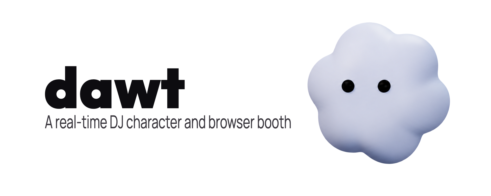

<picture>
  <source media="(prefers-color-scheme: dark)" srcset="docs/images/dawt-cover-dark.png">
  <source media="(prefers-color-scheme: light)" srcset="docs/images/dawt-cover-light.png">
  
</picture>

# dawt

Dawt is a DJ character and browser booth for [Afterhours](https://github.com/robertschultz/afterhours).
Unreal Engine renders the stage and Dawt moves to the playing deck’s beat grid.

## Quick start

On macOS, install Unreal Engine 5.8, Xcode, Node.js 24, and Python 3. Open
`unreal/DotPerformance.uproject` and build its modules when Unreal prompts you.

```sh
npm --prefix web/src ci
npm --prefix web/src run build
python3 scripts/launch.py
```

[Open the standalone stage](http://127.0.0.1:8170/) to preview Dawt and cue moves.
For music, run `python3 scripts/launch.py --dj` and [open the DJ booth](http://127.0.0.1:8170/dj).
The booth uses VirtualDJ and a local [Afterhours](https://github.com/robertschultz/afterhours)
service. Set `DOT_AFTERHOURS_ENGINE` to your engine checkout if it’s not
already running. Choose **Hear stream** for music in the browser.

## Booth controls

- **Booth controls** opens the queue, record search, set pacing, and venue selection.
- **Cinematic camera** follows record pulls, handoffs, and dance accents.
- **DJ activity** shows what Dawt is doing now.
- **Talk** sends voice requests to [Afterhours](https://github.com/robertschultz/afterhours).

## Project layout

- [`unreal/`](unreal/) — Unreal project, character, and venues.
- [`web/src/`](web/src/) — browser interface and Pixel Streaming server.
- [`assets/`](assets/) — Blender scenes, FBX meshes, and material palettes.
- [`scripts/`](scripts/) — launch, import, and macOS audio tools.

Run `python3 scripts/launch.py --stop` to stop the local preview. Runtime
data stays in the ignored `unreal/Saved/` folder.
[Third-party notices](web/epic-license.md) · [Voice client license](web/src/afterhours-license.md)
